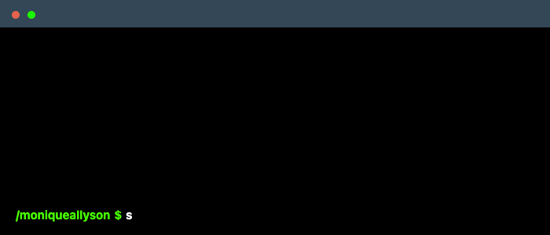

 

<a href="https://git.io/typing-svg">
    
</a>

<div>
    
</div>

<p align="center"><pre>
⣿⣿⣿⣿⣿⣿⣿⣿⣿⣿⣿⣿⣿⣿⣿⣿⣿⣷⣦⣄⡀⠄⠄⠄⠄⠄⠄.                                        ⣿⣿⣿⣿⣿⣿⣿⣿⣿⣿⣿⣿⣿⣿⣿⣿⣿⣿⣿⣿⣿⣿⣿⣿⣿⣿⣿⣿
⣿⣿⣿⣿⣿⣿⣿⣿⣿⣿⣿⣿⣿⣿⣿⣿⣿⣿⣿⣿⣿⣤⡀⠄⠄⠄⠄⠄                                        ⣿⣿⣿⣿⣿⣿⣿⣿⣿⣿⣿⣿⣿⣿⣿⣿⣿⢏⣴⣿⡆⢿⣿⣿⣿⣿⣿⣿
⣿⣿⣿⣿⣿⣿⣿⣿⣿⣿⣿⣿⣿⣿⣿⣿⣿⣿⣿⣿⣿⣿⣿⣦⠄⠄⠄⠄                                        ⣿⣿⣿⣿⣿⣿⣿⣿⣿⣿⣿⣿⣿⣿⣿⣿⢣⣾⣿⣿⡇⣽⣿⣿⣿⣿⣿⣿
⣿⣿⣿⠟⠋⠁⣀⣀⡈⠙⣿⣿⣿⣿⡿⠿⠿⠿⠿⢡⣤⣄⡈⠙⢧⠄⠄⠄                                        ⡏⣼⣿⣶⣌⡙⢿⣿⣿⣿⣿⣿⣿⡿⢟⣵⡿⢿⣿⣿⡇⣿⣿⣿⣿⣿⣿⣿
⣏⣉⣀⣠⣴⣿⣿⣿⣿⣿⣿⣿⣿⣿⣿⣿⠿⠷⠶⠶⠤⣉⠙⠷⣼⣇⠄⠄                                        ⡃⣿⣿⣿⣿⣿⣆⢮⣭⣭⣭⣭⣴⣾⣿⣿⣿⣿⣶⣮⣕⣙⠿⣿⣿⣿⣿⣿
⠿⠿⠿⠿⠿⢿⣿⣿⣿⣿⣿⣿⣿⣿⣿⣿⣷⣄⡀⠄⠄⣿⣿⣶⣈⠙⣄⠄                                        ⣷⡙⣿⣿⣿⣿⣿⢾⣿⣿⣿⣿⣿⣿⣿⣿⣿⣿⣿⣿⣿⠿⣿⣦⡹⣿⣿⣿
⣿⣷⡶⠶⠶⠶⠒⠂⠄⠈⣽⣿⣿⣿⣿⣿⣿⣿⣿⣆⠄⣿⣿⣷⡶⠖⠄⣶                                        ⣿⢋⠸⣿⣿⡿⢏⣾⣿⣿⣿⣿⣿⣿⣿⣿⣿⣿⣿⡟⢁⣶⣿⣿⣷⢸⣿⣿
⣁⣤⣴⣶⣶⠾⠟⠛⠛⢛⣻⣿⣿⣿⣿⣿⣿⣿⣿⣿⠄⣿⣿⣿⣓⠂⠄⣤                                        ⡇⣿⣿⣶⣶⣿⣿⣿⣿⣿⣿⣷⣴⣶⣤⣬⣿⣿⣿⣿⣿⣿⣿⣿⣿⢸⣿⣿
⠟⢛⣉⣥⣤⣶⡶⠛⢋⣉⡴⢟⣙⠶⣋⣿⣿⣿⠿⠛⠄⠛⠻⢧⡙⠾⢂⣄                                        ⡇⣿⣿⣿⣿⣿⣿⣿⣿⣿⣿⣿⣿⣿⣿⣿⣿⣿⣿⠙⠋⣿⣿⣿⢃⣾⣿⣿
⣾⣿⣿⡿⠓⣀⠐⠲⠞⣡⣶⠟⢁⣴⠽⠛⣉⣠⣶⣿⣿⣿⣶⣤⠉⣠⣌⠻                                        ⣷⣹⣿⣿⣿⣿⣿⣿⣿⣿⣿⣿⣿⣿⣿⣿⣿⣿⠟⠃⠈⡹⠈⢰⣿⣿⣿⣿
⣿⣿⣫⣶⣾⣿⡟⣠⣤⣤⠄⣀⣤⣤⣴⣾⣿⣿⣿⣿⣿⣿⡿⢋⡄⢻⣿⣷                                        ⣿⣿⣿⣿⣿⣿⣿⣿⣿⣿⣿⡿⣋⣭⣭⣤⣤⣤⣤⣶⣿⣿⡿⢸⣿⣿⣿⣿

</pre></p>

````
 __________________
< Welcome everyone! >
 ------------------
        \   ^__^
         \  (oo)\_______
            (__)\       )\/\
                ||----w |
                ||     ||
````
🔭 I’m currently working on [](https://github.com/jiyajahnavi/aqualculture-analysis)
